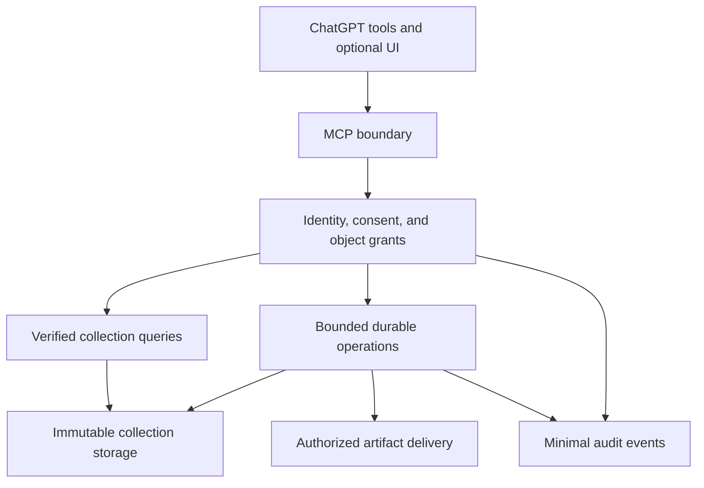

# ChatGPT Integration Delivery Plan

**Project:** LPX Keepmorrow
**Publisher:** Lopix Neural Inc.
**Engineering lead:** Fabio de Sousa Lopes
**Contact:** fabio@lopixneural.com
**Prepared:** November 12, 2026
**Baseline:** Private development version 0.2.0
**Status:** Proposed engineering plan; deployment and account connection have not occurred

## 1. Delivery objective

Deliver a private ChatGPT integration that lets an authorized user inspect,
search, and verify explicitly selected Keepmorrow collections. Extend that
integration with reviewed file intake and selective recovery after its identity,
consent, resource, and operational boundaries are demonstrated.

The first useful milestone is an actual conversation using the five existing
read tools. The second is an authenticated pilot with eligible real content.
The third is an interactive import and recovery workflow with reliable operation
tracking and verified downloads. Public distribution is a later owner decision.

The product remains free and nonmonetized, while its repository and source remain
private and proprietary. All authored code, comments, UI copy, tests, and project
documentation use US English. Original material retains its supplied bytes and
language. Attribution belongs in the interface and documentation, never inserted
into preserved source records.

This plan does not promise account-wide ChatGPT discovery, native sidebar or
Project reconstruction, recovery of files never supplied, universal export
compatibility, unlimited storage, or an approved public release.

## 2. Verified starting point

The planning baseline is remote commit
[`8a984c9b0bfd126cf275fc8073830e3f3339b3f5`](https://github.com/fabiocnd/lpx-keepmorrow/commit/8a984c9b0bfd126cf275fc8073830e3f3339b3f5),
Git tree `714b3abb7208bde2ba6d631e7b3316557e06e9a8`.
The [final baseline CI run](https://github.com/fabiocnd/lpx-keepmorrow/actions/runs/43221569141)
passed all five jobs. The [verification record](../engineering/collection-verification.md)
documents local tests, platform skips, benchmarks, and known limitations.

| Area | Implemented baseline | Remaining evidence or work |
| --- | --- | --- |
| Preservation | Verified directory archives, bounded ZIP intake, original containers, immutable collection generations | Representative real-export compatibility and larger workloads |
| Semantics | Namespaced conversation identity, revisions, branch graphs, provenance, association decisions, explicit artifact states | Additional source shapes and attachment bindings supported by evidence |
| Local interaction | CLI, literal search, revision reading, selection recovery, standalone HTML | Actual ChatGPT interaction and embedded UI |
| MCP | Five read tools, opaque registry IDs, loopback Streamable HTTP, SDK and in-process HTTP tests | Remote identity, scoped authorization, actual account connection |
| Consent | Exact current document versions required before content I/O | Human acceptance recorded independently of model arguments |
| Operations | Handled-failure cleanup, no-replacement publication, bounded admission | Durable job records, restart reconciliation, cooperative cancellation |

Important current costs are part of the baseline. A content query verifies all
archive bytes and reparses the catalog. A new generation copies previous
captures. One global MCP admission slot remains occupied until its worker
finishes, including after client cancellation. These behaviors must inform the
pilot's workload envelope; internal resource ceilings are not service promises.

## 3. Platform and product gates

### 3.1 Account capability must be observed

Record the actual target ChatGPT account and workspace, available custom-MCP
options, connection permissions, and the execution host. GitHub authentication
does not establish the ChatGPT identity. An old browser login or subscription
label is insufficient evidence of current capability.

OpenAI documents custom MCP installation with a server URL or supported tunnel,
authentication configuration, installation, and invocation in a conversation.
Workspace restrictions apply. The first account experiment must prove this path
with synthetic data. [S1]

### 3.2 Full-history content is a product-policy question

The current Plugin Guidelines restrict processing of certain information,
including authentication secrets, government identifiers, protected health
information, and payment-card information governed by PCI DSS. An arbitrary
history export can contain such material. [S7]

Before promising broad archive ingestion through the plugin, determine the
applicable policy scope and a defensible eligibility boundary. Do not assume
that private installation, a tunnel, a checkbox, or an automated sanitizer
creates an exemption.

The proposed pilot keeps originals in the owner's controlled preservation
environment and registers only a separately reviewed eligible collection for
ChatGPT. This is a scope proposal, not proof of eligibility. A derivative must
identify its parent and omissions. Restricted originals must not become
reachable through artifact links, source JSON, raw ZIPs, metadata, or errors.
If the intended broad use case cannot meet the applicable platform requirements,
retain the local preservation product and narrow the connected feature set.

### 3.3 Transport recommendation

| Candidate | Proposed use | Dependency and consequence |
| --- | --- | --- |
| Secure MCP Tunnel | Preferred private-pilot candidate | Confirm actual Platform organization and workspace access; keep the tunnel client healthy |
| Authenticated HTTPS endpoint | Fallback when a tunnel is unavailable, or a later hosted service | Select operator, host, identity provider, region, budget, and operational policy |
| Public distribution | Separate later milestone | Stable reachable HTTPS endpoint, published disclosures, release review, and owner authorization |

The documented tunnel uses outbound connectivity. Its permissions are separate
from ChatGPT connection permissions; the authorization server is not
automatically tunneled. Current limits include a 120-second absolute request
deadline and a 10 MiB serialized envelope. It supports private connections, not
public plugin distribution. Recheck these conditions during implementation. [S2]

A tunnel changes reachability, not the application's responsibility to identify
the caller and authorize each object. Private material must not be served by
simply removing loopback restrictions or forwarding an unauthenticated port.

## 4. Proposed architecture

Retain the deterministic Python core. Use the validated Python 3.12 development
environment as the initial server candidate, with separately pinned integration
dependencies. Add a compact TypeScript component only where an explicit user
decision or a readable result benefits from UI. No engine rewrite is justified
by the current evidence.

For a single-owner pilot, evaluate one service and one bounded worker with a
transactional local store for operations and grants. SQLite is a candidate for
that deployment; confirm process ownership, locking, backup, and recovery before
adopting it. Multiple replicas or a broader service require a new persistence
and coordination decision. A broker, distributed workers, Kubernetes, a vector
database, and an additional model service are not dependencies of the pilot.

Keep authorization and user interaction outside the archive algorithms. Create
new modules only when a phase introduces a concrete responsibility:

| Proposed location | Responsibility | Earliest phase |
| --- | --- | --- |
| Existing `integrations/chatgpt/` | Transport, tool schemas, host integration, sanitized result envelopes | P1 |
| `src/keepmorrow/access/` | Principal, grants, policy decisions, consent records | P3 |
| `src/keepmorrow/operations/` | Operation journal, admission, attempts, idempotency, cancellation | P5 |
| `src/keepmorrow/transfers/` | Authorized input acquisition and output delivery | P4 spike, P5 implementation |
| `ui/chatgpt/` | MCP Apps component, styles, accessibility, interaction tests | P4 |
| `deploy/` and `docs/operations/` | Selected deployment configuration and operator runbooks | P3 onward |

These are proposed boundaries, not directories to scaffold without behavior.
The existing archive, importer, catalog, and format packages retain their roles.

## 5. Identity, consent, and content authorization

### Identity and grants

Use a supported OAuth flow with an established identity provider. The OpenAI
authentication contract includes discovery, protected-resource metadata, PKCE,
resource-bound tokens, and validation of issuer, audience, expiry, and scopes.
Copy callback configuration from the actual connection and prove the selected
registration method in the account. A custom API-key shortcut does not replace
this user authorization flow. [S3][S10]

The proposed enforcement order is:

1. Validate the authenticated principal.
2. Load current policy acceptance and processing authorization.
3. Resolve the principal's grant for the requested collection and generation.
4. Check the permitted operation and artifact scope.
5. Admit the bounded work, then access content.

The source `account_namespace` remains provenance metadata. It must not select
the authenticated owner. Opaque IDs also require authorization; their
unpredictability alone is insufficient. Validate grants on list results, page
cursors, revisions, jobs, recovery plans, and artifact requests. Start with one
real pilot owner, but test with at least two simulated identities.

### Human acceptance

Account linking, agreement to terms, privacy acknowledgment, and approval of a
particular processing scope are distinct decisions. Implement a trusted,
authenticated consent interaction before real connected content access. It may
initially be a small application page; a complete embedded dashboard is not
required for P3.

The server record should contain the subject, document versions and digests,
purpose, recipient, collection generations or selected upload handle, permitted
operations, deliberate action time, expiry, and revocation state. It should not
contain conversation bodies, raw tokens, source paths, or unnecessary device
identifiers. Protect the interaction against forged submissions and replay.

No model-callable tool may create acceptance merely by sending a Boolean or the
current version strings. Tools can expose document links and consent status
without opening user content. A bounded read-session grant can cover repeated
searches within the same approved scope. This new hosted contract must not
silently change the CLI's per-invocation acceptance rule.

Changing recipients, material policies, operation classes, or generations beyond
the grant requires a new decision where appropriate. Revocation blocks future
admission and disclosure. Define its ordering against the durable publication
authorization decision described in Section 8, and revalidate later delivery
requests. Data already transmitted cannot be recalled. The design follows the OPC's emphasis on
clear purposes, recipients, consequences, and meaningful choices. It does not
determine legal applicability or enforceability by itself. [S8]

### Untrusted content

Messages, titles, filenames, URLs, and attachment descriptions remain data.
An instruction inside an imported conversation cannot expand a grant, select
another user's collection, initiate a network fetch, or alter retention.
Keep operational credentials outside model-visible results. Tool annotations
describe behavior; the server must enforce it. [S11]

## 6. Phased delivery and exit evidence

Every phase ends with a short evidence record containing the source revision,
configuration, test inputs, observed outcome, and remaining limits. Engineering
work can proceed within already authorized scope; deployment-specific decisions
are resolved when they become concrete.

| Phase | Deliverable | Dependency | Provisional effort |
| --- | --- | --- | ---: |
| P0 | Scope, data eligibility, account and host decisions | Current baseline | 1–2 engineer-days |
| P1 | Actual synthetic ChatGPT connection | P0 account capability | 1–2 engineer-days |
| P2 | Real-export compatibility evidence, kept local | P0 authorized sample | 2–4 engineer-days |
| P3 | Authenticated private read-only pilot | P1, P2, eligible data and policy decisions | 4–7 engineer-days |
| P4 | Compact interaction UI and file-transfer feasibility | P3 | 3–5 engineer-days |
| P5 | Durable import and selective recovery | P4 transfer proof and P3 grants | 6–12 engineer-days |
| P6 | Measured operating envelope and controlled pilot release | P5 | 3–5 engineer-days |

### P0 — Resolve the boundaries

Confirm the target account/workspace independently of the GitHub account.
Inspect available connection options when execution is authorized. Select the
synthetic pilot corpus and document the eligible-content boundary. Record the
host operator, storage location, proposed identity provider, recipient list,
retention decisions, and monthly operating-budget ceiling before they affect
real material. Prefer existing suitable resources.

**Exit:** a short decision record identifies the intended route and fallback,
who controls each data copy, unresolved external dependencies, and the exact
scope that can proceed. No real archive is connected merely to discover whether
the account supports the feature.

### P1 — Prove the actual ChatGPT connection

Use one synthetic collection and the five existing tools. Prove tool discovery,
initialization, direct and paraphrased requests, follow-up identifiers, bounded
results, unknown IDs, missing declarations, disconnect, and reconnect. Record
actual host/origin forwarding, negotiated protocol, supported capabilities,
and metadata-refresh behavior. The pinned `mcp==1.29.0` is a tested baseline,
not proof of support for every current authentication or UI extension. Isolate
any necessary SDK upgrade and rerun the affected contracts. Keep the existing
DNS-rebinding controls; configure the intended route explicitly. Measure full
content-call duration for the small pilot collection against the selected
route's deadline with operational headroom before admitting that workload.

This transport experiment may use synthetic-only access before P3 authentication
is complete. The result must be labeled accordingly. A tunnel credential or
successful tool call must not be recorded as proof of an end-user identity.

**Exit:** evidence from the actual ChatGPT conversation shows the correct five
tools and results, plus rejection and reconnect cases. Failure to obtain the
required account capability is an explicit blocked route, not a simulated pass.

### P2 — Validate one representative export locally

Obtain an explicitly authorized export outside Git and routine CI. Preserve its
digest and original bytes. Independently record expected conversations,
branches, supplied files, known omissions, and relevant source fields.
Compare these expectations with the parser report and selected recovery.

Resolve discrepancies with a documented parser contract and authorized,
sanitized structural regression fixtures. Do not expand every limit to accept
one file, infer projects from titles, or silently drop unsupported records.
The sample's availability and schema differences can change this phase's effort.

A conversation document above the current 32 MiB ceiling is an explicit
re-estimation trigger. Preserve its bytes and report unsupported interpretation
while evaluating incremental parsing or another bounded, faithful approach.
That change needs its own semantic, memory, and failure evidence; increasing
all limits is not the default resolution.

**Exit:** independent expectations reconcile with the supported interpretation,
all supplied files have explicit outcomes, binary hashes agree, and unsupported
material remains visible. Compatibility claims name the reviewed shape; they
do not generalize to every account or future provider export. Only separately
eligible selections can advance to P3.

### P3 — Establish the authenticated read-only pilot

Implement the identity, object-grant, and consent boundaries in Section 5.
Define operator configuration, encrypted transport, credential handling,
revocation, and content-free diagnostics. Use one explicitly allowed real owner
and a small reviewed collection. The initial installation stays private.

Test wrong identity, guessed IDs, changed generation, missing acceptance,
expired tokens, and revoked sessions. Unauthorized requests must fail before
selected-content I/O. Separately read malicious synthetic content under a valid
grant and verify that any induced request outside that grant fails before
additional unauthorized access. Prove the five tools in ChatGPT after
the successful consent interaction. Confirm that this pilot's full-content
queries fit the measured route budget. A live application agreement must reflect
the actual data flow and recipient before real content is connected.

**Exit:** Fabio can browse, search, read, and verify the approved collection
inside ChatGPT; scope, omissions, and failures are understandable. A second test
identity cannot observe its existence or content beyond the documented error
contract. Removing the connection and revoking its grant prevent further use.

### P4 — Add a focused interface and prove transfer

Build a compact collection picker, coverage summary, revision view, operation
review, and progress/error states. Use the standard MCP Apps bridge and keep
tools useful without UI. Preserve authoritative state on the server; widget
state may hold presentation preferences. Keyboard use, long titles, narrow
viewports, empty states, and partial coverage require actual host tests. [S4]

The file API documents optional selection of existing uploads, a local-upload
fallback, temporary download URLs, and declared file parameters. Feature-detect
those capabilities. The documented input shape includes `download_url`,
`file_id`, `mime_type`, and `file_name`; the latter two are optional values. [S5]

Test small ZIP, JSON, image, and opaque binary fixtures through the actual host.
Compare received hashes independently. Exercise expired references, cancelled
selection, missing metadata, rejected types, and size limits. If native intake
is unavailable, evaluate a separately authorized minimal upload page; its domain,
authentication, storage, and policy are part of the same review.

Separately prove delivery of a newly generated recovery package. A local path,
`sandbox:` URL, API file ID, or legacy Actions response is not assumed to be an
MCP download mechanism. A scoped backend download is a candidate fallback only
after host, authentication, and content-policy behavior are observed.

**Exit:** the actual host can deliver the intended user-selected inputs and one
verified output under explicit grants, or the supported fallback is documented
and tested. Visual and interaction evidence is required; HTML unit tests alone
do not establish UI quality.

### P5 — Add durable import and recovery operations

Introduce reviewed operation plans, input handles, resource reservations,
idempotency, a transactional journal, and one bounded worker. Add cooperative
cancellation at safe copy/parse/verification boundaries. Keep status, cancellation,
and authorization responsive while heavy work runs.

Expose import and recovery through server-owned destinations. Never expose an
arbitrary filesystem destination or the raw local `restore` interface to a
model. Package selected records and explicitly bound files, then verify the
result before making it downloadable. Return explicit partial-coverage outcomes.

**Exit:** identical retries resolve to one operation, conflicting key reuse
fails, intentional later captures remain possible, and restart cannot create
unverified success or a duplicate publication. The delivered package verifies
after download and contains exactly the documented selection. Existing sources
and completed generations remain unchanged.

Specify a separate recovery-container contract. The initial proposal is a
non-ZIP64 ZIP containing the directory archive's unchanged `manifest.json` and
`payload/` layout, using supported stored or deflated entries. Use a provisional
ceiling of 1 GiB for both encoded output and expanded package content, subject
to any lower measured host, quota, or transfer limit. Count wrapper metadata
and paths in its own intake budget. This is a conservative pilot scope, not an
observed transfer capability or a change to the core's 10 GiB ceiling.

Provide a documented unpack-and-verify command or equivalent verifier that
extracts into a new bounded destination, checks the outer package, and runs the
existing archive and collection validation. Test this complete round trip from
the actual download. Oversized output must fail explicitly without truncation;
ZIP64 or a larger package format requires a separate contract and validation.

### P6 — Demonstrate the operating envelope

Measure actual process RSS, temporary storage, I/O, cold and warm latency,
overload, and cancellation on the selected host. Exercise process restart,
insufficient disk, interrupted transfer, expired downloads, revoked access,
dependency failure, and rollback. Validate retention cleanup and backup recovery
without resurrecting revoked grants.

**Exit:** a versioned private release has an explicit workload envelope, measured
budgets, reproducible installation, operator runbook, prior-version rollback,
and accurate support and privacy disclosures. Public submission is not part of
this exit criterion.

## 7. Proposed remote operation contracts

The names below are design proposals. Only the existing five read tools are
implemented in version 0.2.0.

| Contract | Required behavior |
| --- | --- |
| Existing collection tools | Derive principal from credentials; filter objects and cursors by grants; return bounded excerpts and coverage |
| `get_consent_status` | Read minimal policy/grant metadata without opening collection content |
| `prepare_import` | Under prior intake consent, stage an authorized file handle, validate bounded input, and produce a reviewable operation plan |
| `prepare_recovery` | Bind selected conversations, revisions, and artifacts to one immutable generation; report scope and omissions |
| `start_import` / `start_recovery` | Require a server-recorded human review of the plan; validate idempotency and resource reservation; return an operation ID |
| `get_operation` / `cancel_operation` | Enforce ownership; report durable state; remain responsive outside the heavy-worker slot |
| `get_recovery_artifact` | Resolve only the operation's verified output and authorized delivery grant; expose no storage path |

Preparation is itself processing and may create temporary files. Its consent
scope must precede intake; confirmation of the final operation must not be used
to justify an earlier undisclosed upload. A changed plan, input digest, target
generation, or selection invalidates the previous review.

Keep files outside MCP JSON bodies. Validate any supported fetch origin,
redirect, timeout, resolved network destination, and actual byte count. Never
follow URLs embedded in imported content. Use server-generated storage names;
display names remain untrusted. Serve binary downloads as attachments and do
not activate untrusted HTML, SVG, scripts, or executables in privileged previews.

Results should identify the operation, generation, verification stage, counts,
coverage, omissions, and bounded error category. A successful byte operation
with incomplete semantics remains distinct from complete interpretation.

## 8. Operation persistence and recovery

Persist the subject, consent/grant reference, operation type, canonical parameter
digest, input digest or handle, idempotency key, attempt ownership, state,
cancellation request, and verified output identifier. Keep credentials and
content out of the journal.

Suggested states are `prepared`, `queued`, `running`, `verifying`, `completed`,
`partial`, `cancel_requested`, `cancelled`, `interrupted`, `failed`, and `expired`.
Define legal transitions and retry classification before implementation.
`partial` describes a verified result with documented coverage limits; a crash
must never be relabeled as semantic partial success.

Idempotency is scoped to the authenticated operation. Repeating the same key and
parameters returns the same operation; reusing the key with different parameters
fails. A new deliberate capture can use a new key even when its bytes match an
earlier capture. Input equality does not erase a meaningful capture event.

Publication needs a restart protocol that reconciles both the journal and the
filesystem. Record the intended generation and verify staged bytes. Then make
a durable publication-authorization decision serialized against revocation,
using a transaction or equivalent grant-version fencing. A revocation committed
before that decision prevents publication. If authorization commits first,
publication may finish privately; later revocation prevents new disclosure and
applies the declared retention/cleanup policy to that output.

Publish without replacement, then record completion. After a crash between
publication and the status update, verify and reconcile the existing result.
An obsolete worker attempt must not publish after a newer attempt owns the job.
Test both orderings of concurrent revocation and publication authorization.

Begin with restart reconciliation and safe restart of bounded stages. Per-file
resume is a later optimization if measured workloads justify its complexity.
A journal alone does not establish payload crash durability. Specify and test
the chosen filesystem's synchronization and ordering contract before promising
survival of a host or power failure.

Cancellation must not release resources while a worker continues using them.
On revocation, stop new admission and prevent new delivery under that grant.
Revalidate artifact requests through the delivery boundary; an already issued
bearer URL with no online authorization check cannot promise immediate
revocation. Define interruption of active streams explicitly, acknowledging
that bytes already transmitted cannot be recalled. Already copied bytes follow
the selected cleanup policy. A forced stop may produce an interrupted operation
requiring reconciliation, never a completed result.

## 9. Performance and capacity plan

The first pilot retains full verification and uses a measured small collection.
The 0.2.0 benchmark is a baseline experiment, not a capacity commitment. The
effective input limit is the smallest applicable host, intake, semantic,
storage, and temporary-space constraint.

| Existing ceiling | Current value | Planning consequence |
| --- | --- | --- |
| Archive | 10 GiB total, 2 GiB per file, 10,000 entries | Generated files and repeated captures also consume the budget |
| Source JSON | 32 MiB per document, 128 MiB aggregate per capture | A ZIP within its byte limit can still exceed semantic limits |
| Catalog | 64 MiB, 64 captures, 200,000 nodes | Decoded objects, rendering, and serialization require additional memory |
| MCP | 64 KiB request, 512 KiB structured result, 50 primary rows | Keep payload transfer separate and paginate |

Source: the repository's archive, importer, catalog, and MCP contracts. These
ceilings must not become advertised upload limits without deployment evidence.

Use the existing benchmark plus synthetic workloads for many files, large
binaries, dense metadata, wide branches, repeated captures, and near-limit
failures. Record actual RSS and disk peaks in addition to `tracemalloc`.
Measure repeated interaction, not only a single import.

Proposed budget-setting procedure:

1. Freeze the host, dependency set, workload, and concurrency level.
2. Measure warm and cold runs, response sizes, bytes read/written, and memory.
3. Choose a pilot envelope with explicit operational headroom.
4. Record numerical latency, memory, disk, and cancellation targets as approved
   pilot budgets, then verify them with sufficient samples.
5. Keep long work asynchronous and bound admission, queue length, and retries.

A candidate control-plane target is a p95 below two seconds for admission,
status, and cancellation requests on the declared host. This is an engineering
proposal, not a current measurement or a target for full archive verification.
No import throughput or maximum collection size is promised before measurement.

Repeated byte verification is the first optimization to investigate if it harms
interaction. A cache or index requires a new integrity contract: immutable
generation identity, trusted manifest binding, writer ownership, authorization,
invalidation, and explicit last-verified semantics. A TTL or modification time
alone must not silently replace verification. Retain an explicit full check and
verify bytes used for recovery. Add concurrency only after the I/O and memory
profile justify it.

## 10. Storage, retention, and operating cost

An input ZIP can coexist with extracted files, the preserved original container,
prior generations, a staged new generation, and a recovery package. Reserve
space for the complete operation before accepting heavy work. A practical
capacity model is:

`retained generations + active uploads + extraction + staged generation + pending outputs + headroom`

Record cost drivers for host uptime, storage, replicas, download traffic,
identity service, monitoring, and support. This plan quotes no monthly price
because no host, retention period, or workload has been selected. Preserve the
free-product decision with an owner-approved operating ceiling and admission
quotas; reject new work explicitly when capacity is exhausted.

Before real hosted processing, document the following schedule. Durations are
deliberately unresolved until purposes, operator responsibilities, and applicable
requirements are reviewed. The OPC guidance supports purpose-limited retention,
a data inventory, and disposal procedures, including legal constraints. [S9]

| Data class | Required decision and verification |
| --- | --- |
| Owner's original files | Remain outside application deletion authority; identify independent backup/sync behavior |
| Temporary uploads and extraction | Maximum age, normal/failure cleanup, startup reconciliation, storage-pressure response |
| Completed collections | Owner access, preservation purpose, retention, export, and controlled disposal |
| Recovery packages | Availability period separate from collection retention |
| Download grants | Short expiry, scope, revocation, and protection from log/referrer leakage |
| Consent/security records | Minimum necessary metadata, access controls, justified retention |
| Backups and replicas | Expiry, disposal propagation, and revocation preserved after restore |
| Results already returned to ChatGPT | Clear recipient disclosure; no promise that Keepmorrow deletion removes the recipient's copies |

Changing the deployment requires updating the privacy notice and acceptance
presentation to match actual behavior. Terms must describe supported scope and
lawful risk allocation; they must not be represented as complete immunity.
Qualified counsel should review the operator, audience, jurisdictions, records,
retention, incident response, and draft protections before public use.

## 11. Verification and release controls

Retain the Linux/Windows Python 3.11/3.14 core matrix and the separate MCP/schema
job. Add tests only when the associated boundary is implemented. Real exports
remain outside Git, routine CI, and ordinary logs.

| Test group | Required outcome |
| --- | --- |
| Identity and object isolation | Wrong or expired credentials, guessed IDs, foreign cursors/jobs/artifacts, and spoofed namespaces cannot reach content |
| Human consent | Current version strings without a recorded interaction fail; decline prevents Keepmorrow-controlled intake; material changes require new scope |
| Revocation | Future calls and delivery fail; concurrent revoke/publish tests follow the durable authorization ordering; already transmitted bytes are acknowledged |
| Untrusted content | Archived instructions, malicious URLs, HTML, SVG, and binary names cannot change permissions or activate code |
| Intake and delivery | Hashes match through the real path; expired handles, redirects, partial transfers, and unavailable features have explicit outcomes |
| Operation lifecycle | Duplicate retries, conflicting keys, cancellation, worker restart, disk exhaustion, and crash-after-publication reconcile correctly |
| Preservation | Originals and prior generations remain unchanged; selection omits unrelated recognized containers and reports missing material |
| Host experience | Direct, indirect, follow-up, ambiguous, unsupported, and write requests select the intended behavior |
| Operations | Logs omit content and secrets; retention, backup restore, and rollback are demonstrated |

OpenAI's testing guidance calls for actual conversation evaluation and metadata
refresh after tool or UI changes. Record selected tools, arguments, outcomes,
errors, and confirmation behavior using synthetic evaluation inputs. [S6]

Release immutable private build artifacts and versioned configuration. Keep the
previous approved executable available. Rollback must disable new admission,
preserve captured material, reconcile running jobs, and restore a compatible
application version. A schema migration needs a recoverable original and a
tested downgrade or forward-recovery strategy.

For the later multiuser service, add tenant-aware quotas, fair admission,
isolation of storage and jobs, and cross-principal tests at every boundary.
Do not infer multiuser readiness from a single-owner pilot.

Package branded installation only after the connection works. Current OpenAI
packaging documents a root `plugin.json`, optional MCP configuration and assets,
and OpenAI-specific mappings. Authentication and UI remain server concerns.
Use the actual registered server identifier and keep proprietary licensing;
documentation examples do not select this project's license. [S12]

## 12. Prioritized implementation backlog

All items below are planned, not completed.

| ID | Priority | Work item | Completion evidence |
| --- | --- | --- | --- |
| KM-101 | P0 | Account, transport, and content-eligibility record | Actual capability evidence and permitted pilot scope |
| KM-102 | P0 | Synthetic ChatGPT connection | Five tools work in the actual account; rejection and reconnect cases recorded |
| KM-103 | P0 | Representative local export validation | Independent coverage expectations and byte verification reconcile |
| KM-104 | P0 | Identity and object grants | Two-identity negative tests pass before content access |
| KM-105 | P0 | Server-side consent and scoped sessions | Tool arguments cannot manufacture assent; revocation works |
| KM-106 | P0 | Private read-only pilot | Approved real collection works in ChatGPT with truthful scope and rollback |
| KM-107 | P1 | Compact UI and accessibility | Actual host interaction and capability fallback evidence |
| KM-108 | P1 | Authorized file input/output spike | End-to-end hashes, expiry, supported types, and documented limits |
| KM-109 | P1 | Operation plans, journal, and idempotency | Same retry returns one job; changed intent fails; new deliberate captures remain valid |
| KM-110 | P1 | One bounded worker and restart protocol | Interrupted and published-but-unrecorded states reconcile; stale attempts cannot publish |
| KM-111 | P1 | Cooperative cancellation and resource reservation | Safe boundaries, responsive control plane, and no premature resource release |
| KM-112 | P1 | Selective recovery and delivery grants | Reviewed scope, verified package, authorized download, explicit expiry |
| KM-113 | P1 | Measured workload envelope | RSS, disk, latency, I/O, overload, and failure evidence on selected host |
| KM-114 | P1 | Retention, incident, release, and rollback runbooks | Disposal, backup recovery, access revocation, and rollback drills |
| KM-115 | P2 | Broader distribution and storage-provider decision | Separate engineering, policy, legal, cost, and owner review |

Google Drive remains a candidate for a later storage adapter. Existing personal
backup automations do not establish a product integration or permission to reuse
their credentials. Keep provider authorization separate from MCP access tokens.

## 13. Effort, sequencing, and decision ownership

The provisional total is **20–37 engineer-days**, approximately **4–8 working
weeks** for one focused senior engineer. P0–P3 account for **8–15 engineer-days**
to reach the authenticated read-only pilot. These are planning estimates, not
measured velocity or promised dates. They exclude waiting for account access,
sample provision, provider approval, legal review, and public submission.

P1 and P2 can overlap. Protocol review, UI design, documentation, and negative-test
design can also proceed independently. Security integration, actual host testing,
and publication reconciliation still require coordinated review. AI assistance
does not remove those dependencies or justify a guaranteed schedule reduction.

Re-estimate after P1 and P2. Substantial source-schema differences, an unavailable
account feature, incompatible identity-provider behavior, or an unsupported
download path requires a revised range before proceeding with that workstream.

| Decision | Responsible role | Required by |
| --- | --- | --- |
| Target account/workspace and permitted collections | Fabio as product owner | P0/P1 |
| Applicable plugin content boundary | Engineering and product owner; platform clarification if needed | Before real connected content |
| Host, operator, region, provider, and cost ceiling | Product owner with engineering recommendation | P3 |
| Identity, consent, grants, and operation design | Engineering; qualified legal review for legal presentation | P3/P5 |
| Retention periods, privacy requests, and incident responsibilities | Product owner and qualified counsel, implemented by engineering | Before relevant hosted processing |
| Measured capacity and release evidence | Engineering and reviewer | P6 |
| Public availability, distribution, and support commitments | Fabio after engineering and legal review | Separate release decision |

## 14. First implementation work order

Begin with KM-101 and KM-102: establish the actual account capability and connect
one synthetic collection using the current read tools. In parallel, prepare the
independent coverage checklist for KM-103. Record the result and re-estimate the
authenticated pilot before adding a file-upload workflow.

The first demonstration is complete only when a real ChatGPT conversation
discovers the server, performs a bounded query, reports an unsupported request
accurately, and recovers from a connection interruption. A local SDK pass or a
mock interface cannot substitute for that evidence.

## 15. Primary source register

Reviewed on November 12, 2026. Recheck changing platform requirements when the
associated phase is implemented. Platform facts are distinguished above from
proposed engineering decisions and unresolved owner/legal choices.

| ID | Source | Planning use |
| --- | --- | --- |
| S1 | [OpenAI: Add custom MCP server](https://developers.openai.com/api/docs/guides/custom-mcp-server) | Actual account connection and permissions |
| S2 | [OpenAI: Secure MCP Tunnel](https://developers.openai.com/api/docs/guides/secure-mcp-tunnels) | Private connectivity, constraints, and public-distribution boundary |
| S3 | [OpenAI: Authentication](https://developers.openai.com/plugins/build/auth) | Supported identity integration |
| S4 | [OpenAI: Add UI to your MCP server](https://developers.openai.com/plugins/build/chatgpt-ui) | Shared UI bridge and optional host capabilities |
| S5 | [OpenAI: Plugin reference](https://developers.openai.com/plugins/reference) | File-selection and file-parameter contracts |
| S6 | [OpenAI: Connect and test your plugin](https://developers.openai.com/plugins/deploy/connect-chatgpt) | Actual conversation and UI evaluation |
| S7 | [OpenAI: Plugin guidelines](https://developers.openai.com/plugins/plugin-guidelines) | Content eligibility and disclosure requirements |
| S8 | [OPC: Meaningful consent](https://www.priv.gc.ca/en/privacy-topics/privacy-for-businesses/appropriate-handling-of-personal-information/collecting-personal-information-and-consent/consent/gl_omc_201805/) | Understandable decisions and processing scope |
| S9 | [OPC: Limiting use, disclosure, and retention](https://www.priv.gc.ca/en/privacy-topics/privacy-laws-in-canada/the-personal-information-protection-and-electronic-documents-act-pipeda/p_principle/principles/p_use/) | Purpose-based retention and disposal design |
| S10 | [MCP: Authorization specification](https://modelcontextprotocol.io/specification/2026-07-28/basic/authorization) | Resource authorization contract |
| S11 | [OpenAI: Security and privacy](https://developers.openai.com/plugins/guides/security-privacy) | Server enforcement and data minimization |
| S12 | [OpenAI: Package your plugin](https://developers.openai.com/plugins/build/plugins) | Packaging after integration validation |

Related repository documents: [current adapter](chatgpt-integration.md),
[collection workflow](collection-workflow.md), [import contract](import-contract.md),
[consent boundary](consent-boundary.md), [roadmap](../product/roadmap.md),
[decision register](../governance/decision-register.md),
[performance policy](../engineering/performance-policy.md), and
[legal research](../research/legal-basis.md).
