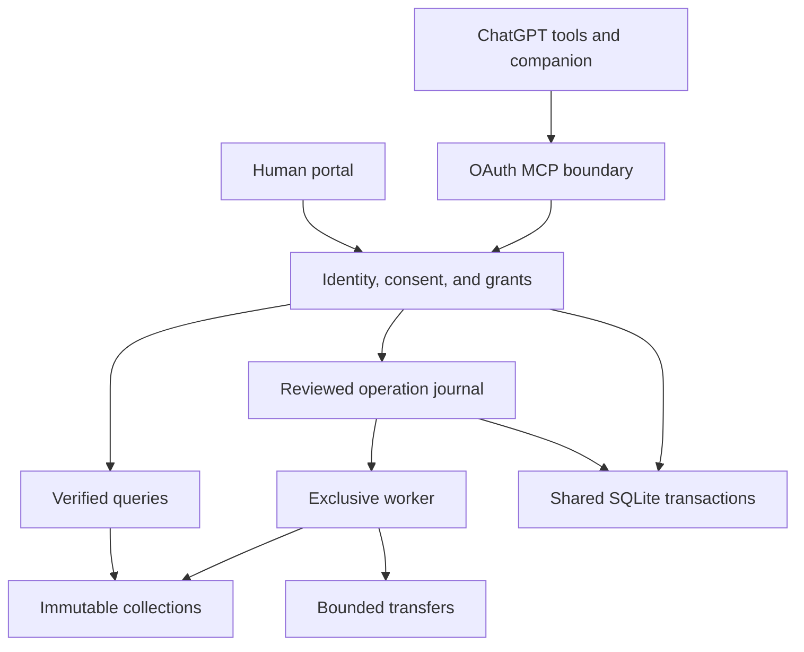

# System Overview

**Implemented version:** 0.3.0 development candidate
**Reviewed:** November 12, 2026

LPX Keepmorrow preserves selected directories or compatible export ZIPs and builds
an immutable conversation collection over the supplied originals. The private
service coordinates authenticated access, trusted human decisions, recoverable
operations, and bounded transfers around that deterministic core.

## Responsibility boundaries

| Package or surface | Responsibility | Boundary |
| --- | --- | --- |
| CLI and `consent` | Validate explicit current policy declarations before selected-content I/O | Local declarations do not authenticate a person |
| `archive` | Inventory, copy, hash, assemble, verify, and recover bytes | Separate new destinations; no remote provider writes |
| `formats` | Bound JSON bytes, depth, and lexical tokens before decoding | Domain validation still follows structural preflight |
| `importers` | Validate ZIP intake and parse the experimental mapping profile | Preserve unsupported material and report gaps |
| `catalog` | Identity, revision/occurrence reconciliation, graphs, associations, queries, views, and selection | Bounded in-memory metadata and literal scans |
| `access` | Principals, current policy acceptance, exact grants, expiry, and withdrawal | No model-callable acceptance writer |
| `persistence` | Private SQLite connections, explicit transactions, and schema versions | One operator-controlled local database; no distributed replicas |
| `operations` | Immutable plans, human reviews, idempotency, admission, fencing, and restart reconciliation | No per-file resume or automatic unbounded retry |
| `transfers` | Owned upload handles and portable package construction/unpacking | Independent encoded and expanded limits; no arbitrary URL fetch |
| `application` | Resource generations, authorization lineage, execution, budgets, owned scratch, and setup | One process, one worker, one content-I/O slot |
| `integrations/chatgpt` | OAuth verification, MCP tools, trusted portal, and streaming delivery | Live identity provider and ChatGPT installation remain unverified |
| `ui/chatgpt` | Typed MCP Apps companion and official SDK bridge | Human acceptance and operation review occur in the trusted portal |

The deterministic core and persistence components use the Python standard
library. Optional HTTP, OAuth, and MCP dependencies belong to the integration
boundary. The legacy five-tool loopback adapter remains a synthetic development
surface; local operator service mode exposes the portal without MCP.

## Collection and publication path

1. Validate identity, exact processing scope, current policy acceptance, and limits.
2. For service writes, persist a typed plan and obtain a separate human review.
3. Reserve resources and claim a fenced worker attempt. Receive input only through
   a previously authorized upload or explicitly selected CLI path.
4. Preserve originals, parse supported records, and write derived metadata in a
   proven operation-owned workspace. Never execute source content.
5. Independently validate staged bytes, catalog relationships, and expected output.
6. Serialize publication authorization against revocation in the shared immediate
   SQLite transaction, then atomically publish without replacing an existing path.
7. Verify and register the published generation; record complete or partial
   semantic coverage. Release the reservation only after executor cleanup.

A publication decision committed before revocation may finish privately. Every
later disclosure still checks current access. Publication is atomic visibility;
SQLite durability does not establish power-loss durability for payload files.

## Identity, consent, and lineage

An authenticated principal is the exact configured issuer/subject pair. A source
account namespace is provenance and never selects the authenticated owner.
Opaque identifiers require authorization; guessing difficulty is not a policy.

The portal records document versions and digests, resource, generation, purpose,
recipient, permitted actions, deliberate acceptance, expiry, and withdrawal.
Single-use challenges and CSRF checks protect human decisions. No MCP tool can
create acceptance or review a plan by supplying a boolean.

Queued and running operations remain bound to the exact reviewed grant, version,
and acceptance receipt. Completed descendants require their own current scope
and every required completed ancestor scope. A fresh human acceptance can renew
an ancestor's exact resource/generation/action; a child grant alone cannot restore
that ancestor. Historical plans and published bytes remain unchanged.

## Files, derivatives, and delivery

Original ZIPs and supplied regular files are preserved byte-for-byte. Supported
relative-path evidence binds available artifacts to conversations. Missing,
unresolved, unsupported, and external references remain distinct; URLs are not
followed. The parser's compatibility remains experimental until a representative
authorized real export is validated.

Selected recovery produces normalized selected records with exact bound artifacts.
It omits recognized whole conversation exports and original ZIPs that can contain
unrelated material. Intact arbitrary attachments may still contain other data;
selection does not redact their internals. Full originals stay in the parent.

The portable ZIP retains the collection manifest and payload. Its service delivery
receipt has a separate generation and binds the ZIP digest. Download requires the
package's exact scope and current lineage. HTTP delivery checks session, grants,
resource availability, and expiry before and after each 64 KiB read. Already
transmitted bytes cannot be recalled.

## Failure and resource model

The worker holds an OS lock for its entire lifetime. Persisted epochs and attempt
tokens reject obsolete owners. Startup first recovers proven workspaces and upload
pins, then reconciles publication, then runs retention cleanup. Unknown or ambiguous
directories are preserved for operator review. A timed-out shutdown retains worker
ownership while its executor remains active.

Status, listing, and cancellation use bounded metadata paths outside the content
slot. Content reads and writes share that slot; database work and uninterruptible
system calls can still affect latency. Fixed error categories avoid returning
source text, credentials, or private paths.

Default service limits are lower than reusable core limits: 128 MiB per upload,
512 MiB collection payload, 1 GiB encoded/expanded package ceilings, a 2 GiB
operation reservation, and a 4 GiB managed logical budget. The full upload pool
is accounted separately. These bounds are admission rules, not throughput or
filesystem quota guarantees.

Copying and full verification process O(B) payload bytes. Inventory ordering uses
O(F log F) comparisons; graph checks use O(V + E). Literal search scans retained
text after full archive verification. Extending a generation copies previous
payloads. JSON and catalog metadata are bounded but materialized; total memory
is not constant. The [service benchmark](../../benchmarks/PRIVATE_SERVICE_BENCHMARK.md)
records the measured synthetic workload and its limits.

## Deployment and distribution status

The local service and integration contracts are implemented and synthetically
tested. Actual ChatGPT interaction, a live identity-provider registration,
a selected host/tunnel, real-export compatibility, and approved operational/legal
policies remain external gates. The source is being prepared for an open-source
transition; no public license or deployment is implied by these components.

See [access control](access-control.md), [operation journal](operation-journal.md),
[transfer contract](transfer-contract.md), [trusted portal](trusted-portal.md),
[runbook](../operations/private-service-runbook.md), and
[private pilot validation](../engineering/private-pilot-validation.md).
